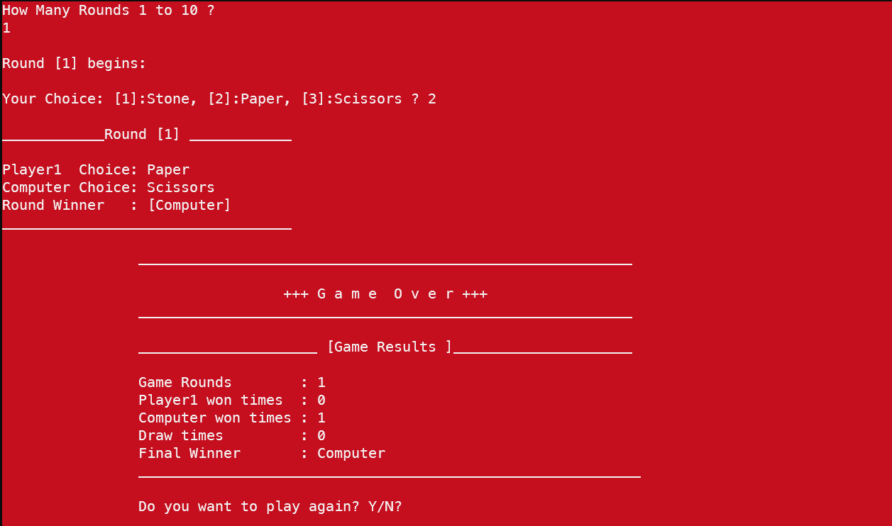
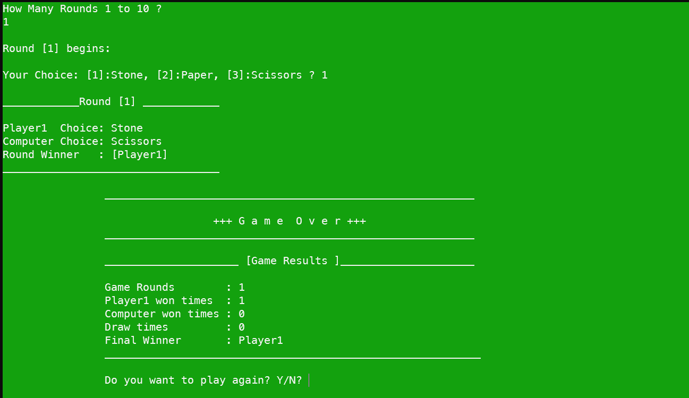
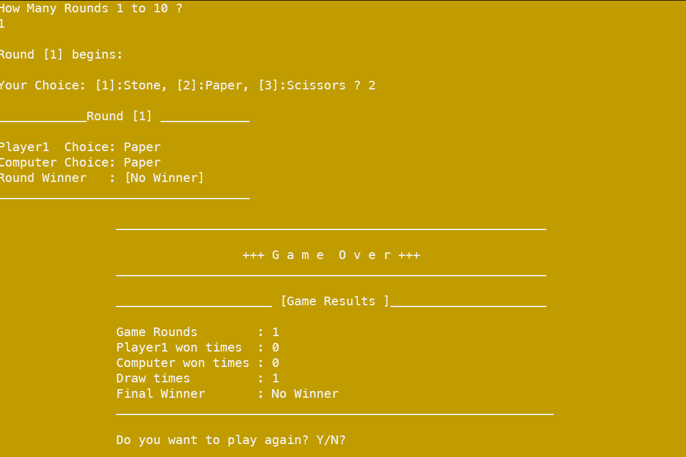


# 🪨 Rock Paper Scissors Game (C++)

A console-based implementation of the classic Rock-Paper-Scissors game where the player competes against the computer across multiple rounds, with automatic score tracking and a color-coded console UI.

## 🎓 Training Source
This project was developed as part of the **ProgrammingAdvices** roadmap by Dr. Mohammed Abu-Hadhoud.
- **Course:** Algorithms & Problem-Solving — Level 2
- **Stage:** Foundational (pre-OOP)
- 🔗 [programmingadvices.com](https://programmingadvices.com/)

## 🎯 Project Objectives
- Practice **structured programming** in C++ before moving to OOP.
- Organize game logic using `enum` and `struct` instead of raw variables.
- Apply modular design by splitting logic into single-responsibility functions.
- Handle randomization and input validation robustly.

## ✨ Features
- Play multiple rounds (1–10) against the computer.
- Random computer choices using `rand()` with proper seeding.
- Round-by-round result display.
- Automatic score tracking (Player wins / Computer wins / Draws).
- Dynamic console color feedback (green for player win, red for computer win).
- Replay option without restarting the program.

## 🧩 Key Components
| Component | Description |
|---|---|
| `enGameChoice` | Enum for choices (Stone, Paper, Scissors) |
| `enWinner` | Enum for outcomes (Player1, Computer, Draw) |
| `stGameResults` | Struct holding full session results |
| `WhoWonTheRound()` | Evaluates single round winner |
| `PlayGame()` | Runs the full game loop |


## 🖥️ Example Gameplay


*Example of a round where the Computer wins.*


*Example of a round where the Player wins.*


*Example of a round ending in a Draw (No Winner).*


## 📂 Project Structure

```text
c05-Rock-Paper-Scissors/
├── c05-Rock-Paper-Scissors.sln
├── .gitignore
├── README.md
├── screenshots/
│   ├── gameplay1.png
│   ├── gameplay2.png
│   └── gameplay3.png
└── c05-Rock-Paper-Scissors/
    ├── c05-Rock-Paper-Scissors.cpp
    ├── c05-Rock-Paper-Scissors.vcxproj
    └── c05-Rock-Paper-Scissors.vcxproj.filters


```
## 🛠️ Tech Stack
- **Language:** C++
- **Paradigm:** Structured Programming
- **Libraries:** `<iostream>`, `<cstdlib>`, `<ctime>`

## ▶️ How to Run

### Using Visual Studio (Recommended)
1. Open the `c05-Rock-Paper-Scissors.sln` file in Visual Studio.
2. Press `Ctrl + F5` (Run without debugging) or click the green **Play** button.
3. The game will launch in a console window.

## 🧠 What I Practiced At This Stage
This was an early project in my journey, built **before** I studied OOP. It helped me solidify:
- Designing structured console applications.
- Separating logic into reusable functions.
- Managing state using `struct`.
- Improving program readability — which later made the transition to OOP much smoother.

## 👤 Author
**Fatoun Al-Abdullah**
- 💼 [LinkedIn](https://www.linkedin.com/in/fatoun-al-abdullah-94b6991b4/)
- 🐙 [GitHub](https://github.com/Futooni)

## 📄 License
This project is open source and free to use for educational purposes.
